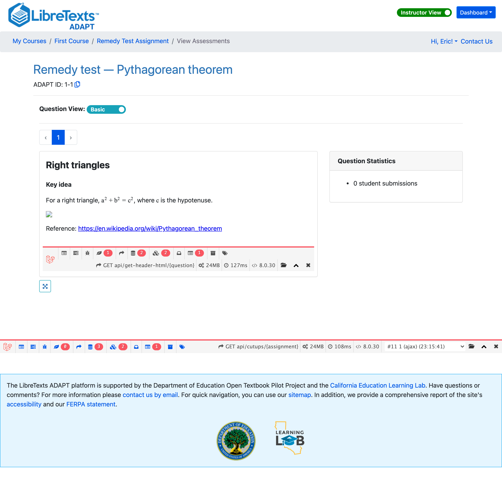
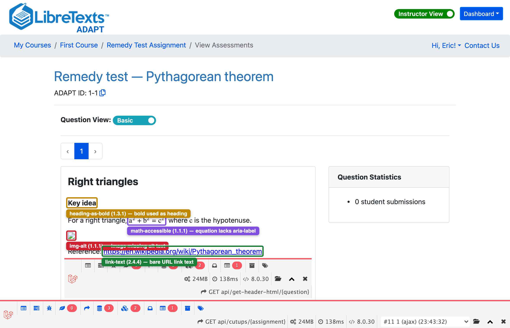
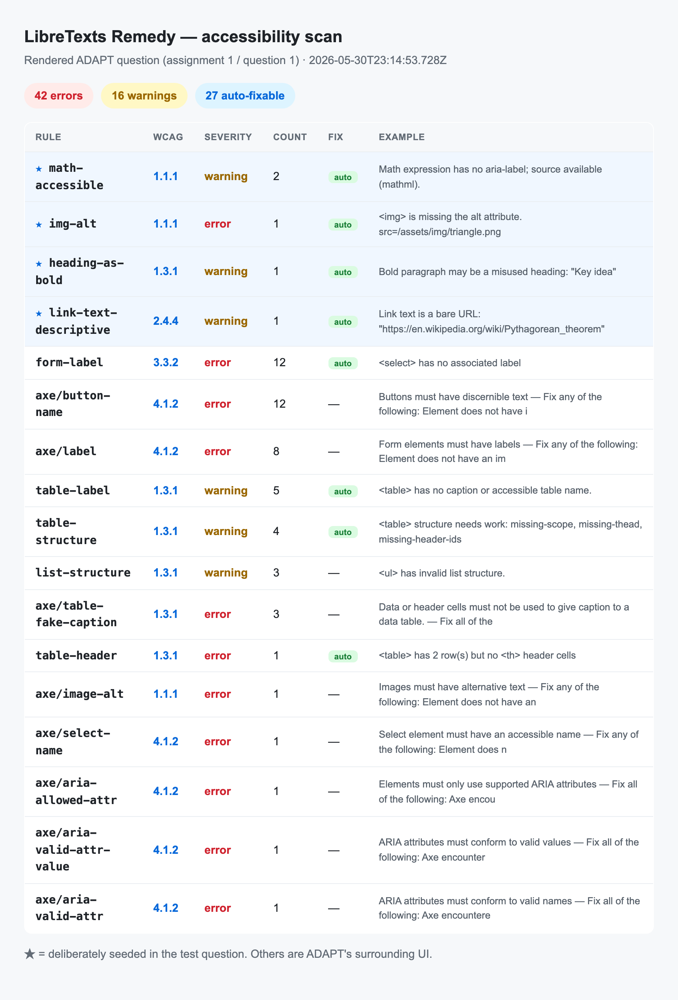
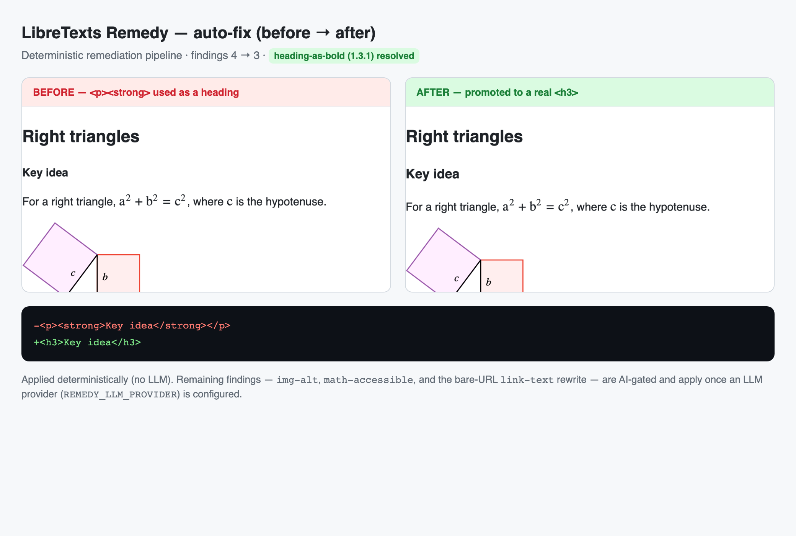
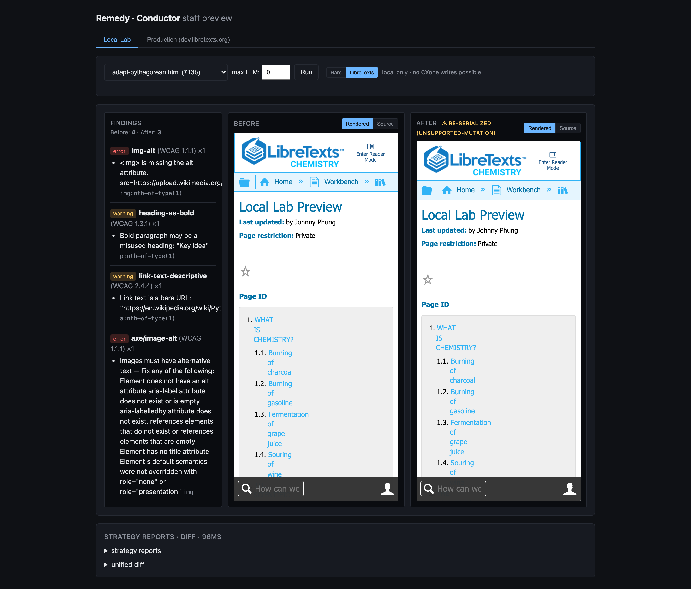

# ADAPT ↔ Remedy integration — spec & evidence

This documents how the bridge integrates ADAPT with LibreTexts Remedy, the
findings that shaped it, and the proof-of-concept evidence.

## Why a headless browser is required
ADAPT renders questions **client-side** — the Vue SPA fetches question content
and **MathJax v2** typesets it in the browser. There is no server-rendered
question HTML, so the only way to scan what a learner actually sees is to drive
a real browser, wait for typesetting, and capture the live DOM.

## Findings (verified against a running ADAPT)
1. **Auth is a JWT in a cookie named `token`.** ADAPT's API guard is
   `tymon/jwt-auth`; the SPA reads its JWT from the `token` cookie. The bridge
   sets that cookie. Use a **service-account token** in production.
2. **The question content is served at `/api/get-header-html/{id}`** as a
   standalone document that loads MathJax and typesets — so the bridge can render
   it **directly** (`RENDER_MODE=iframe`), skipping the SPA shell for a faster,
   more deterministic capture. `RENDER_MODE=spa` renders the full view and grabs
   the same frame.
3. **MathJax is v2.7.4**, not v3 — wait on `MathJax.Hub.queue` (running/pending),
   not v3's `startup.document`.
4. **remedy-core understands rendered MathJax** — it detects typeset `mjx`/`svg`
   math and flags missing aria-labels (it can describe them via vision), which
   plain axe/pa11y/Lighthouse cannot. Prefer remedy-core for ADAPT math content.

## Proof of concept

A seeded question (heading-as-bold, an alt-less image, a bare-URL link, and the
equation `a² + b² = c²`) was rendered through this exact pipeline and scanned.

**Rendered ADAPT question** (what the bridge captures):

**Findings, mapped onto the rendered elements:**

**Remedy report** — every seeded issue caught, including `math-accessible`:

**Auto-fix (before → after)** — the deterministic pass; AI fixers (alt text,
math descriptions, link rewrites) apply when an LLM provider is configured:

**Remedy's own staff reviewer** (the three-pane view, for context on how
findings can be surfaced for human review):

## Production wiring options
- **On question save** — ADAPT calls the bridge (or enqueues a job) for the
  edited question; findings are stored against the question and surfaced in the
  author UI.
- **Batch sweep** — run `adapt-a11y-scanner assignment <id>` (or iterate courses) on a
  schedule to build an accessibility report across existing content.
- **CI gate** — the CLI exits non-zero when a question has WCAG **errors**.

## Open decisions for DevOps
- Service-account token issuance + rotation.
- Deployment shape (worker / triggered job / cron) and concurrency.
- Findings storage + how they surface to authors.
- `SCAN_MODE=http` response mapping in `src/scanner.ts` if you point at the
  `/v1/validate/html` (axe+pa11y+lighthouse) endpoint vs. a remedy-core-shaped one.
